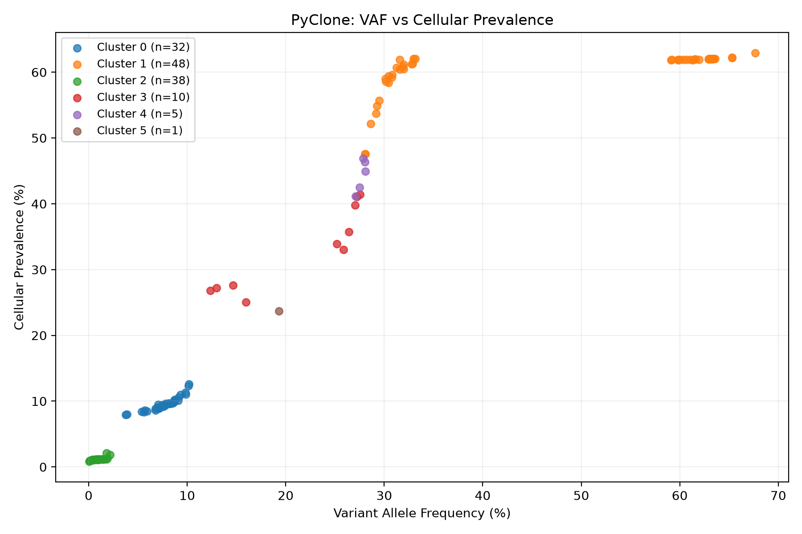

# 04 · Results validation

The real `data/SRR385938.tsv` annotations were joined one-to-one to `evidence/single_test/tables/loci.tsv` by `mutation_id`. Reanalysis confirms **134 mutations, 6 clusters, no missing donor labels, and ARI = 0.6980826145175714**.

## Cluster-by-donor contingency matrix

|cluster_id|NA12156|NA12878|NA18507|NA19240|Total|
|---|---:|---:|---:|---:|---:|
|0|0|32|0|0|32|
|1|0|0|20|28|48|
|2|37|0|1|0|38|
|3|0|0|9|1|10|
|4|0|0|5|0|5|
|5|0|0|1|0|1|
|Total|37|32|36|29|134|

This is a contingency/confusion matrix between an unsupervised partition and known donors. Rows and columns do not have to match one-to-one, and cluster IDs have no intrinsic biological meaning.

The adjusted Rand index compares pairwise partition agreement while correcting for chance. It is invariant to label numbering. A value of 1 means identical partitions; values near 0 correspond to the random-agreement baseline, and negative values are possible. **ARI 0.698 is not 69.8% classification accuracy**, and it establishes neither convergence nor true tumor clones.

Cluster 0 separates NA12878 cleanly. Cluster 2 is mostly NA12156 (37/38). NA18507 is split across several clusters, and cluster 1 combines 20 NA18507 mutations with 28 NA19240 mutations. Thus both merging and splitting remain; cluster 1 cannot be named a pure donor cluster.



## Cluster 1: genotype and frequency

Cluster 1 contains three AB and 45 BB mutations:

|Genotype|Mutations|Mean VAF (%)|Mean per-locus CP (%)|
|---|---:|---:|---:|
|AB|3|32.56|61.99|
|BB|45|48.89|60.10|

Different genotypes can yield different VAFs with similar fitted CP. Similar VAF is not sufficient evidence for common cluster membership. `examine_cluster1.py` prints the donor-by-genotype table and sorted individual loci; see `reports/examine_cluster1.txt`. These CP values are locus-table means, not the grid-based cluster posterior mean.

## Reproduce the validation

```sh
python scripts/validate_pyclone_clusters.py
python scripts/examine_cluster1.py
```

The scripts compute results from the chosen files rather than hard-coding this matrix. They reject multi-sample tables, duplicate mutation IDs, and missing annotations. `reports/confusion_matrix.tsv` is the machine-readable matrix. `reports/cluster_summary.csv` and the figures are generated from the archived results. Assess them alongside [MCMC diagnostics](05-mcmc-diagnostics.md), rather than judging success from ARI alone.
