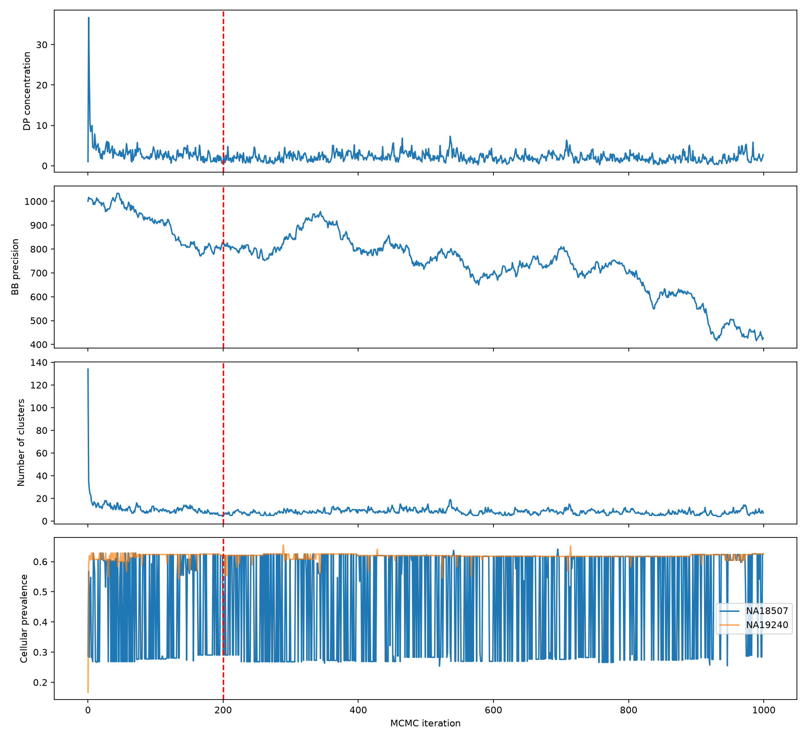

# 05 · MCMC diagnostics and uncertainty

## First versus second retained halves

Burn-in is 200 and thinning is 1. The first half contains saved rows 200–599 and the second half rows 600–999.

|Series|First-half mean|Second-half mean|Retained-chain lag-1 autocorrelation|
|---|---:|---:|---:|
|Concentration alpha|2.2436|1.9193|0.5400|
|Precision|802.5065|639.4730|0.9970|
|Cluster count|8.4350|7.5750|0.7771|
|CP: selected NA18507 mutation|0.4578|0.4986|0.1089|
|CP: selected NA19240 mutation|0.6188|0.6179|0.1403|

Precision drifts strongly and is highly autocorrelated. Mean cluster count also changes. Low short-lag autocorrelation for CP does not exclude slow-parameter drift, switching among modes, or poor overall mixing. **This single chain does not establish convergence and shows signs of nonstationarity or insufficient mixing.** A short chain cannot prove that the sampler will never converge.

## Co-clustering and low-CP events

Mutation 1: `NA18507:BB:chr2:113737630`.
Mutation 2: `NA19240:BB:chr15:50399138`.

|Saved rows|Co-clustering frequency|Mutation 1 CP < 0.4 frequency|
|---|---:|---:|
|200–599|0.4575 (183/400)|0.4625 (185/400)|
|600–999|0.5725 (229/400)|0.3450 (138/400)|
|200–999|0.5150 (412/800)|0.40375 (323/800)|

|Same cluster / NA18507 CP < 0.4|False|True|
|---|---:|---:|
|False|65|323|
|True|412|0|

This 2-by-2 table concerns two events, **not** donor-validation confusion. All 323 low-CP states separate the pair; all 412 co-clustered states have non-low CP. This describes an association in this saved chain, not causation or proof of distinct biological populations.

The 0.515 fraction is a chain occupancy estimate. Autocorrelation and drift mean that 800 retained states are not 800 independent posterior samples. An independent-Bernoulli confidence interval would be inappropriate.

## Burn-in, thinning, ESS, and R-hat

Discarding burn-in does not remove drift from later states. Thinning reduces stored or analyzed states; it cannot repair convergence. Effective sample size (ESS) describes the information loss due to autocorrelation under stationarity assumptions.

The extended script reports a transparent approximate ESS: it sums paired autocorrelations until the first non-positive pair and caps ESS at the number of retained states. This is not rank-normalized bulk/tail ESS and is not a convergence test. For drifting precision, it is only a warning-oriented descriptive calculation.

The resulting estimates are approximately 112.28 for alpha, 1.55 for precision, 29.59 for cluster count, and 383.99/137.74 for the selected CP traces. These estimates neither remove nonstationarity nor establish that these counts of reliable independent posterior draws were obtained. Full outputs are in `reports/diagnostics.tsv`.

A single archived chain does not support a meaningful independent-multichain R-hat. Do not present halves of the same run as independent chains.

Next steps are longer runs with independent seeds, examination of trends and mode occupancy in each chain, comparisons of label-invariant co-clustering events, and suitable multichain rank-normalized R-hat, bulk/tail ESS, and Monte Carlo error estimates. Stable CP estimates and partitions should be discussed only after those checks. Six clusters and an appealing ARI do not establish convergence.
